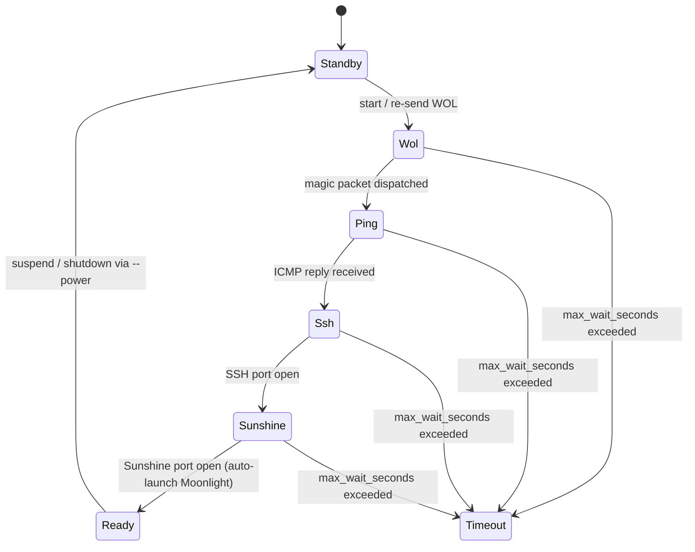
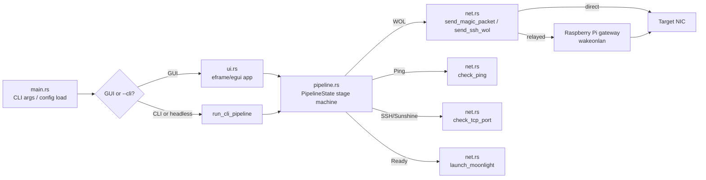

# Wake Workstation

A cross-platform (Windows / Linux / macOS) Rust desktop + CLI utility that automates the entire "wake up my gaming PC and start streaming" sequence for [Moonlight](https://moonlight-stream.org/) / [Sunshine](https://github.com/LizardByte/Sunshine) game streaming setups.

Instead of manually sending a Wake-on-LAN packet, waiting for the box to boot, and then opening Moonlight yourself, Wake Workstation sends the magic packet (directly over UDP broadcast, or via SSH to a Raspberry Pi gateway on the target's LAN), polls the host with ICMP ping, waits for its SSH daemon and Sunshine streaming port to come online, and then automatically launches your installed Moonlight client. It also exposes remote power actions (suspend / reboot / shutdown) over SSH, ships a GUI ([eframe](https://github.com/emilk/egui)/egui) and a scriptable `--cli` mode, and supports multiple named host profiles so you can point it at more than one machine.

> [!NOTE]
> Wake Workstation **orchestrates** an existing streaming setup — it does not install or configure Moonlight or Sunshine for you. Set those up on the client and target machine first.

## Prerequisites

| Requirement | Needed for |
|---|---|
| [Rust toolchain](https://rustup.rs/) (stable, edition 2021) | Building the project |
| `wakeonlan` installed on the Raspberry Pi (or other) gateway host | Pi-gateway WOL mode only ([`send_ssh_wol`](file:///C:/Users/coryp/Downloads/wake-thinkstation-rust-src/src/net.rs#L85-L121) shells out to `wakeonlan -i <broadcast> <mac>` over SSH) |
| SSH server + key-based auth on the gateway and/or target host | Pi-gateway WOL mode, SSH port-check stage, and `--power` actions |
| [Moonlight](https://moonlight-stream.org/) client installed on the machine running this tool | Auto-launch on ready, and the "Launch Moonlight" GUI button |
| [Sunshine](https://github.com/LizardByte/Sunshine) already installed and running on the target machine | The Sunshine-port readiness check (default TCP `47989`) |

On Linux, building an `eframe`/`egui`/`winit`-based GUI typically requires the standard X11 or Wayland development headers to already be installed (e.g. `libx11-dev`, `libxkbcommon-dev`, `libgtk-3-dev` or your distro's equivalents). CLI-only usage has no such requirement.

## Build

```sh
cargo build --release
```

The compiled binary is written to `target/release/wake-workstation` (`.exe` on Windows). Run `cargo test` to run the test suite ([src/tests.rs](file:///C:/Users/coryp/Downloads/wake-thinkstation-rust-src/src/tests.rs)).

## Running

**GUI mode** (default when a display is available):

```sh
./target/release/wake-workstation
```

**CLI mode** — explicit, or auto-selected on Linux when no `DISPLAY`/`WAYLAND_DISPLAY` is set (e.g. over SSH):

```sh
./target/release/wake-workstation --cli
```

**Immediate remote power action** (no wake pipeline, exits after the command completes):

```sh
./target/release/wake-workstation --power suspend
```

On first run, a config file is auto-generated at the default location (see [Configuration](#configuration)) if none exists yet, populated with a `workstation` profile containing generic placeholder values — you must edit it (or override via flags) with your real target IP, MAC address, and SSH username before waking will work.

## CLI flag reference

All flags are optional; any value not supplied falls back to the active profile's config value. Source: [src/main.rs](file:///C:/Users/coryp/Downloads/wake-thinkstation-rust-src/src/main.rs#L17-L95).

| Flag | Alias | Type | Description |
|---|---|---|---|
| `--cli` | | flag | Run in terminal CLI mode without launching the GUI |
| `-p`, `--profile <NAME>` | | string | Activate a named profile from the config file (e.g. `thinkstation`, `server`) |
| `--power <ACTION>` | | string | Execute an immediate remote power action (`suspend`, `reboot`, `shutdown`/`poweroff`) over SSH and exit — skips the wake pipeline entirely |
| `--target <HOST>` | `--ip` | string | Override target IP / hostname |
| `--user <USER>` | | string | Override target SSH username |
| `--mac <MAC>` | | string | Override target MAC address |
| `--broadcast <IP>` | | string | Override the WOL broadcast IP address |
| `--pi-host <HOST>` | | string | Override the Pi gateway host |
| `--pi-user <USER>` | | string | Override the Pi gateway SSH user |
| `--direct-wol` | | flag | Force direct local UDP Wake-on-LAN, bypassing the Pi gateway |
| `--direct-wol-port <PORT>` | | u16 | Override the direct WOL UDP port (default `9`) |
| `--ssh-port <PORT>` | | u16 | Override the SSH port to poll/connect to (default `22`) |
| `--sunshine-port <PORT>` | | u16 | Override the Sunshine streaming port to poll (default `47989`) |
| `--max-wait <SECS>` | `--max-wait-seconds` | u64 | Override the overall pipeline timeout in seconds |
| `--wol-resend <SECS>` | `--wol-resend-interval` | u64 | Override the interval between magic-packet re-sends while waiting |
| `--no-moonlight` | | flag | Do not auto-launch Moonlight once the target becomes ready |
| `--auto-close` | | flag | Auto-close the GUI window once the target is ready |
| `-c`, `--config <PATH>` | | path | Use a custom JSON config file path instead of the OS default |
| `-h`, `--help` / `-V`, `--version` | | | Standard clap-generated help/version output |

## Configuration

Config file is JSON and lives at:

- Windows: `%APPDATA%\wake-workstation\config.json`
- Linux / macOS: `~/.config/wake-workstation/config.json`

(or wherever `--config <PATH>` points). It is created automatically on first run with placeholder values if it doesn't exist yet — see [`load_config_from_path`](file:///C:/Users/coryp/Downloads/wake-thinkstation-rust-src/src/config.rs#L224-L310).

The top level (`AppConfig`) holds an `active_profile` name and a map of named `HostProfile` entries, so you can keep configs for multiple machines side by side and switch between them with `-p <name>` or the GUI's profile picker:

```json
{
  "active_profile": "workstation",
  "profiles": {
    "workstation": {
      "pi_host": "192.168.1.10",
      "pi_user": "pi",
      "thinkstation_ip": "192.168.1.50",
      "thinkstation_user": "user",
      "mac_address": "AA:BB:CC:DD:EE:FF",
      "broadcast_addr": "192.168.1.255",
      "ssh_port": 22,
      "sunshine_port": 47989,
      "sunshine_service": "sunshine.service",
      "max_wait_seconds": 300,
      "wol_resend_interval": 60,
      "sunshine_grace_seconds": 30,
      "direct_wol": false,
      "direct_wol_port": 9,
      "auto_close": false
    }
  }
}
```

> [!IMPORTANT]
> The values above are placeholders. Replace `thinkstation_ip`, `mac_address`, `thinkstation_user`, `pi_host`/`pi_user` (or `broadcast_addr` if using direct WOL) with the real values for your network before use. `mac_address` must resolve to exactly 12 hex digits (`:`, `-`, and `.` delimiters are accepted).

### `HostProfile` fields

| Field | Type | Purpose |
|---|---|---|
| `thinkstation_ip` | string | Target host IP/hostname — pinged, SSH/Sunshine-port polled, and used for `--power` |
| `thinkstation_user` | string | SSH username on the target, used for the SSH port check context and `--power` actions |
| `mac_address` | string | Target NIC MAC address, encoded into the WOL magic packet |
| `broadcast_addr` | string | Broadcast IP the magic packet is sent to (both direct and via `wakeonlan -i`) |
| `pi_host` / `pi_user` | string | Raspberry Pi (or other) SSH gateway host/user for relayed WOL |
| `direct_wol` | bool | Force direct local UDP WOL, skipping the Pi gateway even if `pi_host` is set |
| `direct_wol_port` | u16 | UDP port for the direct WOL magic packet (default `9`) |
| `ssh_port` | u16 | Port polled for the SSH stage, and used for `--power`/SSH connections |
| `sunshine_port` | u16 | Port polled for the Sunshine stage (default `47989`) |
| `sunshine_service` | string | Sunshine systemd service name (part of the profile schema; informational field) |
| `sunshine_grace_seconds` | u64 | Grace period value stored in the profile schema |
| `max_wait_seconds` | u64 | Overall pipeline timeout before the stage machine gives up (`Stage::Timeout`) |
| `wol_resend_interval` | u64 | How often (seconds) the magic packet is re-sent while stuck in the WOL/Ping stages |
| `auto_close` | bool | GUI auto-closes its window once the target reaches `Ready` |

Every field can be overridden per-invocation with the matching CLI flag (see the table above) without editing the file.

## Direct WOL vs. Pi-gateway WOL

Wake ThinkStation can send the Wake-on-LAN magic packet two ways, chosen in [`PipelineState::send_wol`](file:///C:/Users/coryp/Downloads/wake-thinkstation-rust-src/src/pipeline.rs#L182-L255):

- **Direct local UDP broadcast** ([`send_magic_packet`](file:///C:/Users/coryp/Downloads/wake-thinkstation-rust-src/src/net.rs#L62-L82)) — used when `direct_wol: true` or `pi_host` is empty. The machine running Wake ThinkStation broadcasts the magic packet itself on `broadcast_addr:direct_wol_port`. This only works if the controlling machine is on the **same broadcast domain / LAN segment** as the target, since WOL magic packets don't normally route across subnets or over the internet.
- **Pi-gateway relay over SSH** ([`send_ssh_wol`](file:///C:/Users/coryp/Downloads/wake-thinkstation-rust-src/src/net.rs#L85-L121)) — used when a `pi_host` is configured and `direct_wol` is `false`. Wake ThinkStation SSHes into `pi_user@pi_host` (e.g. a Raspberry Pi that stays on and lives on the same LAN as the target) and runs `wakeonlan -i <broadcast_addr> <mac_address>` there. Use this when the machine running Wake ThinkStation is *not* on the target's local network (e.g. connecting remotely over a VPN/Tailscale) but a small always-on device on that LAN can relay the broadcast for you.

If the SSH gateway dispatch fails, the pipeline logs a warning and automatically falls back to a direct local UDP packet.

## Remote power actions

`--power <suspend|reboot|shutdown>` (CLI) or the GUI's power menu run [`execute_power_action`](file:///C:/Users/coryp/Downloads/wake-thinkstation-rust-src/src/net.rs#L241-L304), which SSHes into `thinkstation_user@thinkstation_ip:ssh_port` and runs, depending on the action:

```sh
sudo -n systemctl suspend || systemctl suspend                                   # suspend
sudo -n systemctl reboot  || systemctl reboot  || sudo -n reboot  || reboot        # reboot
sudo -n systemctl poweroff || systemctl poweroff || sudo -n poweroff || poweroff  # shutdown/poweroff
```

> [!IMPORTANT]
> The SSH connection is made with `-o BatchMode=yes`, which means it **will never prompt for a password** — it fails immediately if key-based authentication isn't already set up. Before using `--power`, make sure:
> 1. Your SSH key is authorized on the target (`~/.ssh/authorized_keys`) so `ssh user@target` succeeds non-interactively.
> 2. The target user can run `sudo systemctl suspend|reboot|poweroff` **without a password prompt** (passwordless `sudo -n`), typically via a `/etc/sudoers.d/` entry — otherwise the `sudo -n ...` command fails and falls back to the non-sudo variant, which will only work if the user already has the relevant permission directly.

## Architecture / pipeline stages

The wake sequence is a stage machine ([src/pipeline.rs](file:///C:/Users/coryp/Downloads/wake-thinkstation-rust-src/src/pipeline.rs#L8-L45)) driven by non-blocking background checks, shared by both the GUI ([src/ui.rs](file:///C:/Users/coryp/Downloads/wake-thinkstation-rust-src/src/ui.rs)) and the CLI runner ([`run_cli_pipeline`](file:///C:/Users/coryp/Downloads/wake-thinkstation-rust-src/src/pipeline.rs#L534-L591)):



High-level component flow:



Each polling stage (Ping/SSH/Sunshine) hands its blocking `ping`/TCP-connect work off to a background thread ([`spawn_check`](file:///C:/Users/coryp/Downloads/wake-thinkstation-rust-src/src/pipeline.rs#L477-L531)) so `tick()` never blocks the GUI event loop or the CLI's polling loop.

## License

MIT — see LICENSE.
