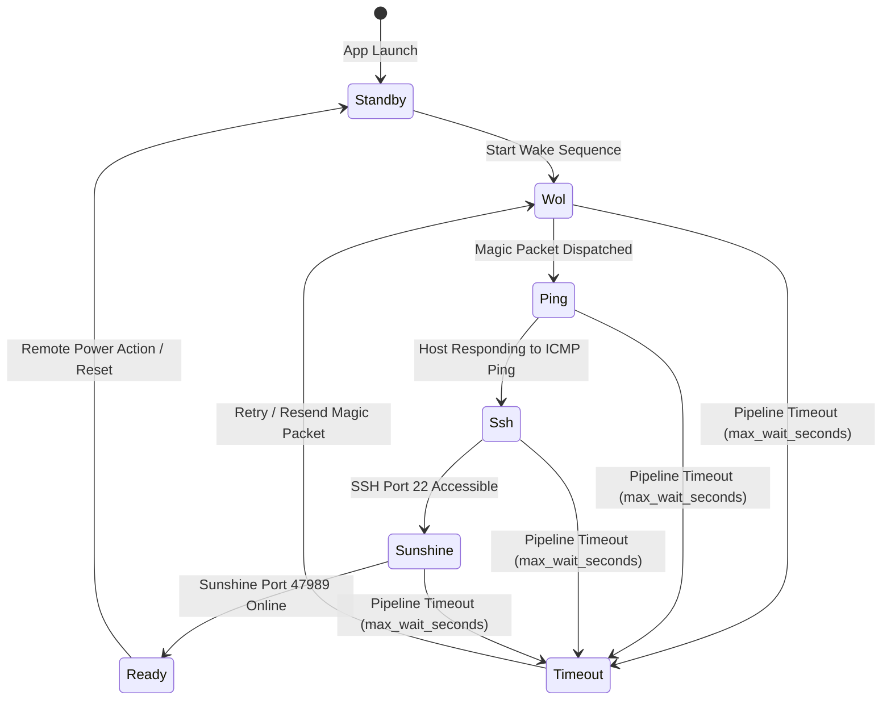
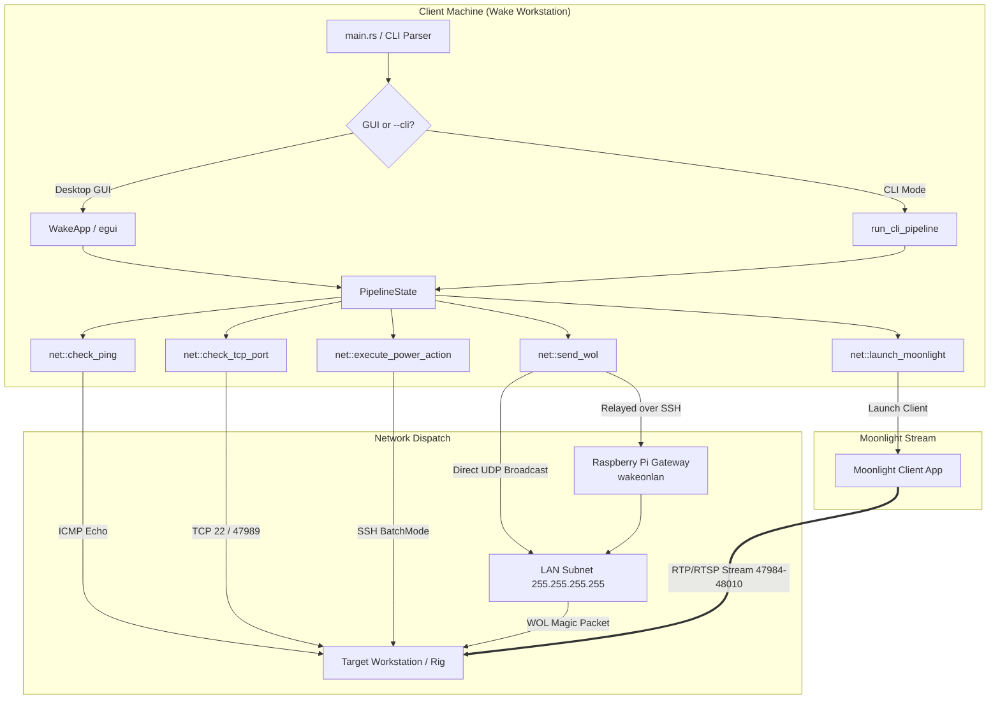

# WakeWorkstation ⚡ — One-Click Remote PC Wake, Health Check & Moonlight Launcher

<div align="center">

[](https://github.com/Cpleasance/wake-workstation/actions)
[](LICENSE)
[](https://www.rust-lang.org)
[](https://github.com/Cpleasance/wake-workstation)
[](https://github.com/emilk/egui)
[](https://moonlight-stream.org)

**A high-performance, cross-platform (Windows / Linux / macOS) Rust desktop GUI + CLI orchestrator that automates the entire "Wake PC via local WOL or Raspberry Pi SSH relay, verify services, and stream" pipeline for [Moonlight](https://moonlight-stream.org/) and [Sunshine](https://github.com/LizardByte/Sunshine).**

[Quickstart](#quickstart) • [Features](#key-features) • [CLI Reference](#cli-flag-reference) • [Configuration](#configuration) • [Moonlight & Sunshine Setup](#moonlight--sunshine-complete-setup-guide) • [Architecture](#architecture--pipeline-stages) • [Troubleshooting](#troubleshooting)

</div>

---

## Overview

Streaming high-end games and GPU workloads to thin clients, laptops, or handhelds (Steam Deck, ROG Ally) using Moonlight and Sunshine is incredible—until you need to power on the remote rig.

Normally, waking up and connecting requires multiple manual steps:
1. Sending a Wake-on-LAN magic packet from your phone or router.
2. Waiting blindly for the machine to POST and boot into the OS.
3. Checking if Sunshine started up and the network stack is ready.
4. Manually opening the Moonlight client.
5. Manually connecting to the host.

**Wake Workstation** transforms this into a single click (or single CLI command). It fires the WOL packet (locally or relayed over SSH via a Raspberry Pi gateway), continuously polls the host's ICMP ping, verifies the SSH daemon and Sunshine streaming port, streams live RTT latency sparklines, and immediately launches Moonlight the moment the host is ready to stream. When finished, you can suspend, reboot, or shut down the host with one click over SSH.

> [!NOTE]
> Wake Workstation **orchestrates** your existing streaming setup—it does not install or replace Moonlight or Sunshine. Set up Sunshine on the host and Moonlight on the client first (see our [Setup Guide](#moonlight--sunshine-complete-setup-guide) below).

---

## Key Features

- 🚀 **Full End-to-End Wake Automation**: Wake-on-LAN -> ICMP Ping reachability check -> SSH daemon check -> Sunshine streaming port check -> Instant Moonlight launch.
- 🌐 **Dual Wake Modes**: Direct local UDP broadcast or secure SSH relay via a 24/7 low-power gateway (e.g. Raspberry Pi) when connecting across subnets or VPNs (Tailscale, WireGuard).
- 🖥️ **Modern Desktop GUI**: Built with [eframe](https://github.com/emilk/egui) / [egui](https://github.com/emilk/egui). Features real-time RTT latency sparklines, 4-stage visual stepper, live diagnostics console with log filters, reachability testing, and modal settings editor.
- ⚡ **Scriptable Headless CLI**: Run `--cli` for terminal workflows, headless scripts, systemd startup hooks, or SSH sessions without an X11/Wayland display.
- 💤 **Remote Power Actions**: Execute non-interactive `suspend`, `reboot`, or `shutdown` over SSH (`--power <action>` or via GUI menu).
- 🗂️ **Multi-Host Profiles**: Seamlessly switch between multiple target rigs (e.g. `workstation`, `gaming-pc`, `home-server`) with JSON profile management and direct GUI import/export.
- 🔍 **Smart Network Diagnostics**: Multi-locale ICMP latency parsing (English, German, French, Spanish, Russian, Chinese, Japanese, etc.), ARP cache MAC validation, and rate-limited WOL packet resends.
- 🛡️ **Hardened & Safe**: Strict input token validation prevents shell injection on SSH commands; console window suppression (`CREATE_NO_WINDOW`) on Windows prevents distracting popups.

---

## GUI Preview & Layout

```text
+-----------------------------------------------------------------------------------+
|  [ WAKE WORKSTATION ]   Profile: [ workstation v ] [Test Ping] [Settings] [Power] |
+-----------------------------------------------------------------------------------+
|                                                                                   |
|     +-----------------------------------------------------------------------+     |
|     |  [ WAKE HOST ]  Stage: Standby | Target: 192.168.1.50 (AA:BB:CC:DD)  |     |
|     |  Latency: 1.2ms [~/\_/\~~]                                            |     |
|     +-----------------------------------------------------------------------+     |
|                                                                                   |
|     [ 1. WOL PACKET ]    [ 2. ICMP PING ]    [ 3. SSH DAEMON ]   [ 4. SUNSHINE ]  |
|       (Direct UDP / Pi)    (Host Reachable)    (Port 22 Open)      (Port 47989)   |
|            [ v ]                [ v ]               [ v ]              [ v ]      |
|                                                                                   |
|     +-- Live Event Diagnostics Console -------------------------------------+     |
|     | [12:00:01] [INFO] Dispatched WOL magic packet to 192.168.1.255:9      |     |
|     | [12:00:08] [OK]   Host responded to ICMP ping (RTT: 1.4ms)            |     |
|     | [12:00:11] [OK]   SSH port 22 is reachable                           |     |
|     | [12:00:13] [OK]   Sunshine streaming port 47989 is online!            |     |
|     | [12:00:13] [INFO] Launching Moonlight game streaming client...       |     |
|     +-----------------------------------------------------------------------+     |
+-----------------------------------------------------------------------------------+
```

---

## Quickstart

### 1. Build or Install

Ensure you have the [Rust toolchain](https://rustup.rs/) installed:

```sh
# Clone the repository
git clone https://github.com/Cpleasance/wake-workstation.git
cd wake-workstation

# Build optimized release binary
cargo build --release
```

The compiled executable will be located in `target/release/wake-workstation` (or `.exe` on Windows).

### 2. Configure Your Host Profile

On first launch, Wake Workstation automatically generates a configuration file with template values. You can configure your target machine either through the GUI **Settings** modal or by editing the JSON config directly.

Default config file location:
- **Windows**: `%APPDATA%\wake-workstation\config.json`
- **Linux / macOS**: `~/.config/wake-workstation/config.json`

Example configuration:

```json
{
  "active_profile": "workstation",
  "profiles": {
    "workstation": {
      "thinkstation_ip": "192.168.1.50",
      "thinkstation_user": "cory",
      "mac_address": "AA:BB:CC:DD:EE:FF",
      "broadcast_addr": "192.168.1.255",
      "direct_wol": true,
      "direct_wol_port": 9,
      "ssh_port": 22,
      "sunshine_port": 47989,
      "max_wait_seconds": 300,
      "wol_resend_interval": 60,
      "auto_close": false
    }
  }
}
```

### 3. Launch & Stream

- **Launch Desktop GUI**:
  ```sh
  ./target/release/wake-workstation
  ```
  Click **Wake Host** or press <kbd>Space</kbd> / <kbd>Enter</kbd>.

- **Launch in Headless CLI Mode**:
  ```sh
  ./target/release/wake-workstation --cli
  ```

- **Perform Remote Power Action**:
  ```sh
  ./target/release/wake-workstation --power suspend
  ```

---

## CLI Flag Reference

All CLI arguments are optional; any omitted flag falls back to the active profile's configuration.

| Flag | Alias | Type | Description |
|---|---|---|---|
| `--cli` | | `flag` | Run in terminal CLI mode without launching the GUI |
| `-p`, `--profile <NAME>` | | `string` | Activate a named profile from config (e.g. `workstation`, `gaming-rig`) |
| `--power <ACTION>` | | `string` | Execute immediate remote power action (`suspend`, `reboot`, `shutdown`) over SSH and exit |
| `--target <HOST>` | `--ip` | `string` | Override target IP address or hostname |
| `--user <USER>` | | `string` | Override target SSH username |
| `--mac <MAC>` | | `string` | Override target network interface MAC address |
| `--broadcast <IP>` | | `string` | Override Wake-on-LAN broadcast IP address |
| `--pi-host <HOST>` | | `string` | Override Raspberry Pi gateway host |
| `--pi-user <USER>` | | `string` | Override Raspberry Pi gateway SSH user |
| `--pi-ssh-port <PORT>` | | `u16` | Override Raspberry Pi gateway SSH port (default `22`) |
| `--direct-wol` | | `flag` | Force direct local UDP Wake-on-LAN, bypassing Pi gateway |
| `--direct-wol-port <PORT>` | | `u16` | Override direct WOL UDP port (default `9`) |
| `--ssh-port <PORT>` | | `u16` | Override SSH port to poll / connect to (default `22`) |
| `--sunshine-port <PORT>` | | `u16` | Override Sunshine streaming port to poll (default `47989`) |
| `--max-wait <SECS>` | `--max-wait-seconds` | `u64` | Override overall pipeline timeout in seconds (default `300`) |
| `--wol-resend <SECS>` | `--wol-resend-interval` | `u64` | Override interval between magic-packet re-sends while waiting |
| `--no-moonlight` | | `flag` | Do not auto-launch Moonlight once host is ready |
| `--auto-close` | | `flag` | Auto-close GUI window once target reaches `Ready` |
| `-c`, `--config <PATH>` | | `path` | Use custom JSON configuration file path |
| `-h`, `--help` / `-V`, `--version` | | | Standard help and version output |

---

## Configuration & Schema Reference

### `HostProfile` Schema

| Field | Type | Default | Description |
|---|---|---|---|
| `thinkstation_ip` | `string` | `"192.168.1.50"` | Target host IP or hostname polled during Ping/SSH/Sunshine checks. |
| `thinkstation_user`| `string` | `"user"` | SSH username on target host for power actions and context. |
| `mac_address` | `string` | `"AA:BB:CC:DD:EE:FF"` | Target NIC MAC address (supports `:`, `-`, or `.` separators). |
| `broadcast_addr` | `string` | `"192.168.1.255"` | Subnet broadcast address for WOL magic packets. |
| `direct_wol` | `bool` | `false` | When `true`, sends local UDP broadcast directly; skips Pi gateway. |
| `direct_wol_port` | `u16` | `9` | UDP destination port for direct WOL (standard is `9` or `7`). |
| `pi_host` | `string` | `"192.168.1.10"` | Gateway IP/hostname used to relay WOL when `direct_wol: false`. |
| `pi_user` | `string` | `"pi"` | SSH username for Raspberry Pi gateway. |
| `pi_ssh_port` | `u16` | `22` | SSH port for Raspberry Pi gateway. |
| `ssh_port` | `u16` | `22` | TCP port polled during the SSH stage and used for `--power`. |
| `sunshine_port` | `u16` | `47989` | TCP port polled to verify Sunshine streaming daemon is up. |
| `sunshine_service`| `string` | `"app-dev.lizardbyte.app.Sunshine.service"` | Informational systemd/Windows service name. |
| `sunshine_grace_seconds`| `u64` | `30` | Optional grace period configured for startup. |
| `max_wait_seconds` | `u64` | `300` | Pipeline timeout before marking stage as failed. |
| `wol_resend_interval` | `u64`| `60` | Interval (seconds) to resend WOL packet if host hasn't responded. |
| `auto_close` | `bool` | `false` | When `true`, GUI closes automatically after Moonlight launches. |

---

## Moonlight & Sunshine Complete Setup Guide

Follow this step-by-step guide to configure your remote workstation/gaming host and client machine.

### 1. Target Host Setup (Sunshine & System Configuration)

#### A. Enable Wake-on-LAN (WOL) in Motherboard BIOS/UEFI & OS
1. **BIOS/UEFI**: Reboot into BIOS -> Advanced / Power Management -> Enable **"Wake on LAN"**, **"Power On By PCI-E"**, or **"Resume By Onboard LAN"**. Disable **"Deep Sleep"** or **"ErP Ready"** (which cuts NIC power when suspended).
2. **Windows NIC Settings**:
   - Open **Device Manager** -> **Network Adapters** -> Right-click your Ethernet adapter -> **Properties**.
   - Under **Power Management**: Check *"Allow this device to wake the computer"* and *"Only allow a magic packet to wake the computer"*.
   - Under **Advanced**: Enable *"Wake on Magic Packet"*.
   - In Windows Control Panel -> **Power Options** -> *Choose what the power buttons do* -> Disable *"Turn on fast startup"* (Fast Startup can prevent WOL from S5 shutdown).
3. **Linux NIC Settings**:
   - Check WOL status with `sudo ethtool <interface>`. Look for `Wake-on: g`.
   - If not enabled, run: `sudo ethtool -s <interface> wol g`.

#### B. Install & Configure Sunshine
1. **Install Sunshine**:
   - **Windows**: Install via WinGet:
     ```powershell
     winget install LizardByte.Sunshine
     ```
     Or download the installer from [Sunshine GitHub Releases](https://github.com/LizardByte/Sunshine/releases).
   - **Linux (Ubuntu / Debian)**:
     ```sh
     sudo apt install ./sunshine-debian-*.deb
     ```
   - **Linux (Flatpak)**:
     ```sh
     flatpak install flathub dev.lizardbyte.app.Sunshine
     ```
2. **Enable Autostart / Background Service**:
   - On Windows, Sunshine installs as a background Windows Service. Ensure the service startup type is set to **Automatic**.
   - On Linux (systemd user service):
     ```sh
     systemctl --user enable --now sunshine
     ```
3. **Firewall Configuration**:
   Ensure the following ports are open on the target host:
   - **TCP**: `47984`, `47989` (Web UI & HTTP), `47990`, `48010`
   - **UDP**: `47998`, `47999`, `48000`, `48002`, `48010`
   - *Windows Defender Quick Command (PowerShell as Admin)*:
     ```powershell
     New-NetFirewallRule -DisplayName "Sunshine Streaming" -Direction Inbound -LocalPort 47984,47989,47990,48010 -Protocol TCP -Action Allow
     New-NetFirewallRule -DisplayName "Sunshine UDP" -Direction Inbound -LocalPort 47998-48002,48010 -Protocol UDP -Action Allow
     ```
   - *Linux UFW*:
     ```sh
     sudo ufw allow 47984,47989,47990,48010/tcp
     sudo ufw allow 47998:48002,48010/udp
     ```

#### C. Configure Passwordless SSH (for `--power` Actions & Gateway Relays)
1. Ensure OpenSSH server is running on the target machine:
   - **Windows**: Install OpenSSH Server via *Optional Features* or run:
     ```powershell
     Add-WindowsCapability -Online -Name OpenSSH.Server~~~~0.0.1.0
     Start-Service sshd; Set-Service -Name sshd -StartupType 'Automatic'
     ```
   - **Linux**: `sudo apt install openssh-server && sudo systemctl enable --now ssh`.
2. Authorize your client SSH public key (`~/.ssh/id_ed25519.pub`) in `~/.ssh/authorized_keys` on the target.
3. For Linux target power actions (`suspend`, `reboot`, `shutdown`), allow passwordless sudo for systemctl commands:
   ```sh
   echo "$USER ALL=(ALL) NOPASSWD: /bin/systemctl suspend, /bin/systemctl reboot, /bin/systemctl poweroff" | sudo tee /etc/sudoers.d/workstation-power
   sudo chmod 0440 /etc/sudoers.d/workstation-power
   ```

---

### 2. Client Machine Setup (Moonlight)

1. **Install Moonlight**:
   - **Windows**: `winget install MoonlightGameStreaming.Moonlight`
   - **Linux (Flatpak)**: `flatpak install flathub com.moonlight_stream.Moonlight`
   - **macOS**: `brew install --cask moonlight`
2. **Initial Pairing**:
   - Launch Moonlight once on your client.
   - Click **Add Host Manually** and enter your target's IP (`192.168.1.50`).
   - Moonlight displays a 4-digit PIN.
   - On the target machine (or via browser), open Sunshine Web UI: `https://<target-ip>:47990` -> **PIN** tab -> Enter the PIN and click **Send**.
3. **Recommended Moonlight Quality & Latency Settings**:
   - **Resolution & Frame Rate**: Match your client display (e.g. 2560x1440 @ 120 FPS or 4K @ 60 FPS).
   - **Video Bitrate**: 50–100 Mbps for local Ethernet/Wi-Fi 6; 20–40 Mbps for remote connections.
   - **Video Codec**: Force **AV1** or **HEVC (H.265)** for superior visual fidelity at lower bitrates.
   - **Audio Configuration**: Stereo or 5.1 Surround.

---

### 3. Raspberry Pi Gateway Setup (Optional Remote Relay)

If you connect to your home network remotely over a VPN (e.g. Tailscale, WireGuard), standard UDP Wake-on-LAN packets cannot cross the subnet router. Wake Workstation solves this by SSHing into a low-power device (like a Raspberry Pi) and running the broadcast locally.

1. Install `wakeonlan` on your Raspberry Pi:
   ```sh
   sudo apt update && sudo apt install -y wakeonlan
   ```
2. Test waking manually from the Pi:
   ```sh
   wakeonlan -i 192.168.1.255 AA:BB:CC:DD:EE:FF
   ```
3. Copy your client SSH public key to the Pi:
   ```sh
   ssh-copy-id pi@192.168.1.10
   ```
4. Set `"direct_wol": false`, `"pi_host": "192.168.1.10"`, and `"pi_user": "pi"` in your Wake Workstation profile.

---

## Architecture & Pipeline Stages

### Pipeline State Machine

Wake Workstation executes a non-blocking asynchronous state machine:



### Component Flow Architecture



---

## Troubleshooting

| Symptom | Probable Cause | Resolution |
|---|---|---|
| **Target does not wake up** | Motherboard PCIe WOL disabled or Fast Startup enabled | Ensure WOL is enabled in BIOS/UEFI. Disable *Fast Startup* in Windows Power Options. Check that NIC drivers have *"Wake on Magic Packet"* enabled. |
| **Ping check times out indefinitely** | Windows Firewall blocks ICMP Echo | On target Windows host, enable rule: `netsh advfirewall firewall add rule name="ICMP Allow incoming V4 echo" protocol=icmpv4:8,any dir=in action=allow` |
| **SSH port check fails or `--power` fails** | OpenSSH not running or key auth missing | Ensure `sshd` service is running on target. Test manual non-interactive login: `ssh -o BatchMode=yes user@target_ip`. |
| **Sunshine check fails on port 47989** | Sunshine service not running or port blocked | Verify Sunshine is running (`systemctl --user status sunshine` or Windows Services). Verify firewall permits TCP `47989`. |
| **Moonlight client does not auto-launch** | Moonlight not installed in standard path | Ensure Moonlight is installed via WinGet, Scoop, Flatpak, or standard Program Files. You can also manually launch Moonlight once the UI shows `Ready`. |
| **Gateway WOL fails over SSH** | `wakeonlan` missing on Pi or SSH key rejected | Install `wakeonlan` on Pi (`sudo apt install wakeonlan`). Verify passwordless SSH: `ssh pi@pi_host wakeonlan --version`. |

---

## Contributing

Contributions, bug reports, and feature proposals are warmly welcomed! Please read our [Contributing Guidelines](CONTRIBUTING.md) for details on code style, running tests (`cargo test`), and our PR process.

---

## License

This project is licensed under the **MIT License** — see the [LICENSE](LICENSE) file for details.

Copyright (c) 2026 **Cory Pleasance**
